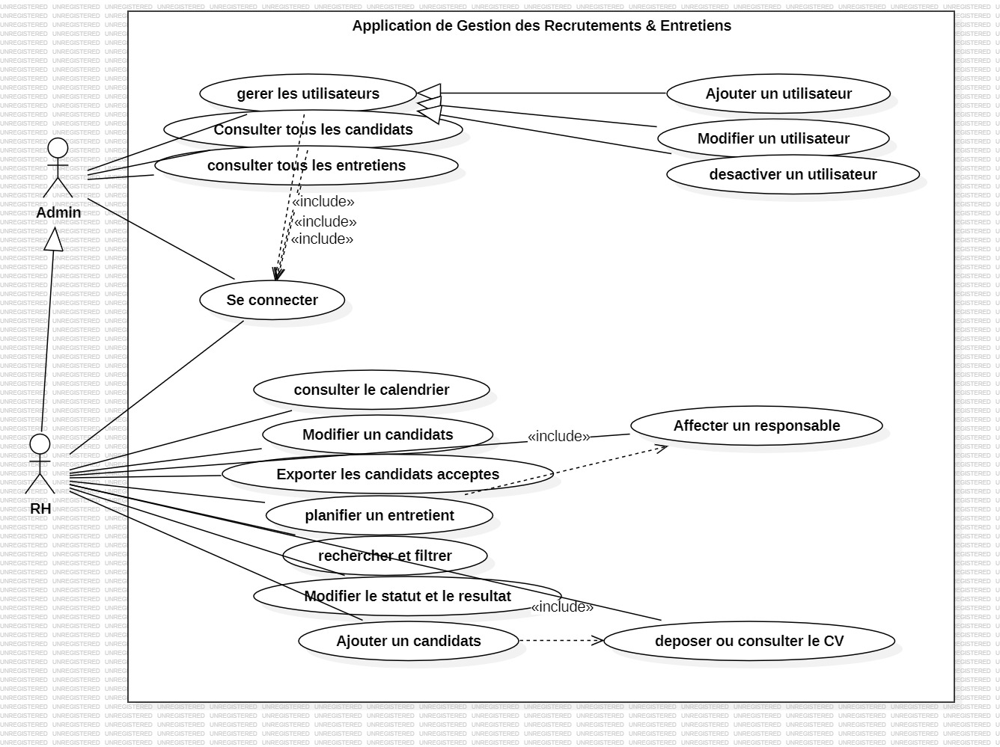
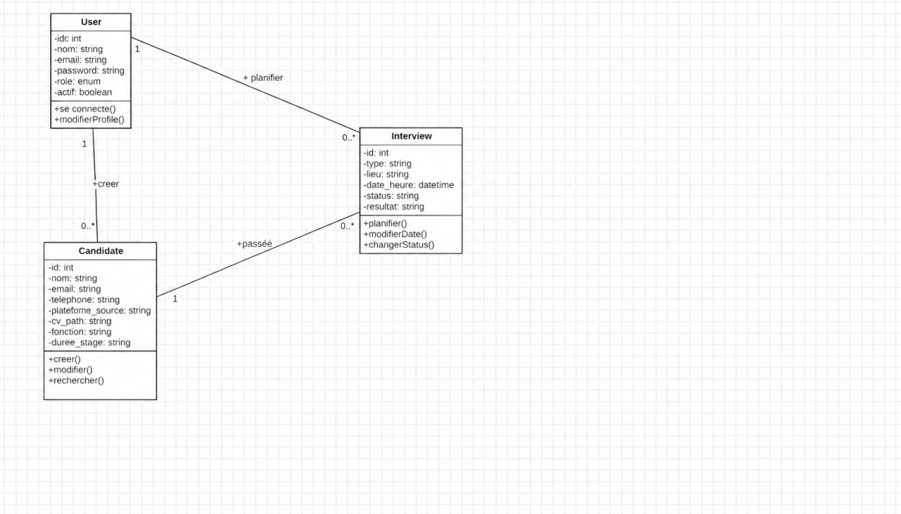
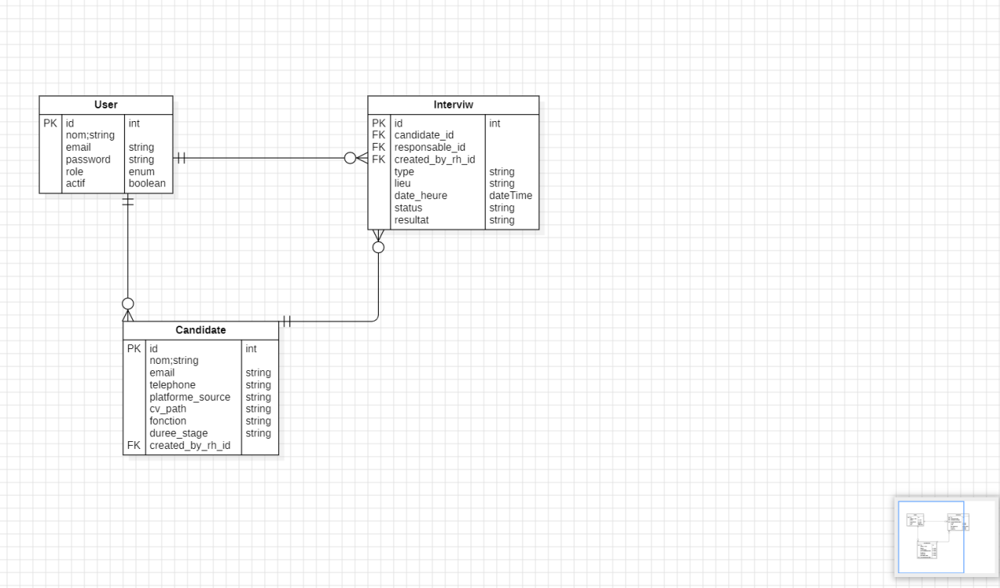

# RecrutPro - Application de Gestion des Recrutements et des Entretiens

## 📝 Aperçu du Projet

**RecrutPro** est une application web full-stack centralisée permettant de digitaliser et d'automatiser l'ensemble du processus de recrutement au sein d'une organisation : de la réception de la candidature jusqu'à la décision finale suite à l'entretien.

### 🌟 Fonctionnalités Clés

* **Sécurité & Accès Restreint (RBAC)** : Aucune inscription publique . La création des comptes RH est exclusivement réservée à l'**Administrateur**.

* **Accès Opérationnel Complet pour l'Admin** : L'Admin dispose d'un accès total pour gérer les utilisateurs, les candidats, les entretiens et consulter la supervision globale.

* **Interface Unifiée (UI/UX)** : Layout moderne avec Sidebar latérale constante et bouton **Déconnexion** fixe en bas de page.

* **Gestion des Fichiers CV (PDF)** : Importation, affichage et téléchargement sécurisé des CVs au format PDF.

* **Calendrier Interactif des Entretiens** : Vue planning (FullCalendar) pour suivre les rendez-vous d'entretiens.


### 1. Diagramme de Cas d'Utilisation (Use Case Diagram)




### 2. Diagramme de Classes (UML Class Diagram)


    

### 3. Modèle Entité-Association (Database ERD)

   

## 🛠️ Tech Stack & Technologies

* **Back-end** : Laravel 11, PHP 8.3, Laravel Sanctum (Token Auth), REST API Architecture.

* **Front-end** : React 19, Vite, React Router v6, Axios, Tailwind CSS, FullCalendar.

* **Base de données** : MySQL 8.0.

## 🚀 Guide d'Installation & Lancement

### Prérequis

* PHP >= 8.3

* Composer

* Node.js >= 18.x & npm

* MySQL

### Étape 1 : Configuration du Backend (Laravel)

1. Naviguez dans le dossier backend :

   ```
   cd backend
   
   ```

2. Installez les dépendances PHP :

   ```
   composer install
   
   ```

3. Copiez le fichier `.env.example` en `.env` :

   ```
   cp .env.example .env
   
   ```

4. Configurez vos accès à la base de données MySQL dans le fichier `.env` :

   ```
   DB_CONNECTION=mysql
   DB_HOST=127.0.0.1
   DB_PORT=3306
   DB_DATABASE=recrutpro_db
   DB_USERNAME=root
   DB_PASSWORD=
   
   ```

5. Générez la clé d'application et exécutez les migrations :

   ```
   php artisan key:generate
   php artisan migrate --seed
   php artisan storage:link
   
   ```

6. Lancez le serveur Laravel :

   ```
   php artisan serve
   
   ```

### Étape 2 : Configuration du Frontend (React + Vite)

1. Naviguez dans le dossier frontend :

   ```
   cd ../frontend
   
   ```

2. Installez les dépendances JavaScript :

   ```
   npm install
   
   ```

3. Lancez le serveur de développement React :

   ```
   npm run dev
   
   ```

## 🔗 Endpoints API REST Principaux

| Méthode | Route | Description | Accès | 
| ----- | ----- | ----- | ----- | 
| `POST` | `/api/login` | Authentification et émission du Token Sanctum | Public | 
| `POST` | `/api/logout` | Révocation du Token et déconnexion | Authentifié | 
| `GET/POST` | `/api/admin/users` | Gestion des comptes RH | Admin Only | 
| `GET/POST` | `/api/candidates` | Consultation et création des fiches candidats | Admin & RH | 
| `GET/POST` | `/api/interviews` | Consultation et planification des entretiens | Admin & RH | 

## 👥 Auteurs

Projet développé par Jihane Jador et Sara Fasraoui